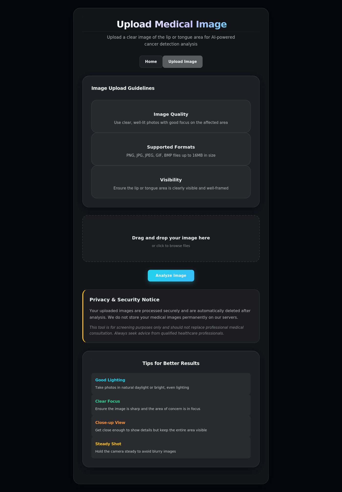
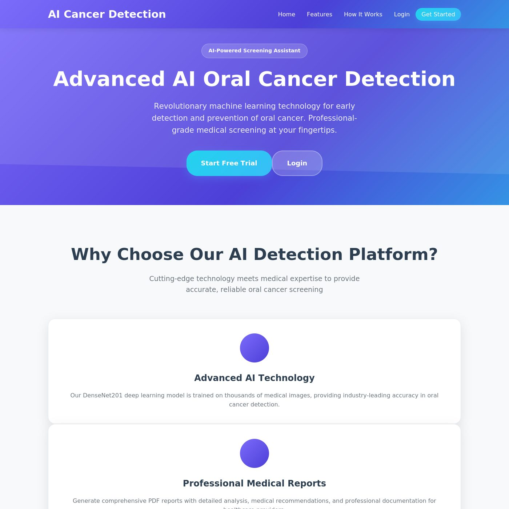
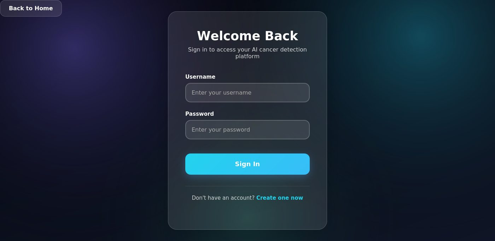

# OralVision AI — Oral & Lip Cancer Prediction System
### *Enterprise Clinical Diagnostic Studio & ULTRON AI Medical Assistant*

[](https://www.python.org/)
[](https://flask.palletsprojects.com/)
[](https://www.tensorflow.org/)
[](https://keras.io/)
[](https://www.docker.com/)
[](LICENSE)

---

## 📌 Project Overview

**OralVision AI** is an end-to-end, clinical-grade deep learning platform engineered for early screening, classification, and visual interpretability of oral, lip, and tongue mucosa lesions. Built around a fine-tuned **DenseNet201** convolutional neural network backbone with **Grad-CAM (Gradient-weighted Class Activation Mapping)** visual attribution, OralVision empowers medical practitioners and researchers to analyze pathology photographs in seconds.

The platform includes **ULTRON AI**, an integrated clinical diagnostic assistant that operates out-of-the-box using a deterministic medical knowledge base (with zero external dependencies and zero cost) or through an optional OpenAI-compatible generative reasoning engine.

### 🔬 Core Diagnostic Scope
OralVision categorizes specimen photographs into three primary clinical classes:
1. **Normal Tissue** — Healthy oral mucosa with intact structural morphology.
2. **Pre-Cancer** — Oral potentially malignant disorders (OPMDs) exhibiting epithelial dysplasia, leukoplakia, or erythroplakia.
3. **Oral Cancer** — Oral squamous cell carcinoma (OSCC) malignancies requiring urgent biopsy and oncology consultation.
4. **Inconclusive Safeguard** — Automatically triggered when top-class certainty is below 60% or when the statistical margin between the top two classes is less than 10%, preventing hazardous misclassification of ambiguous inputs.

> ⚠️ **Academic & Engineering Disclaimer:** OralVision AI is an engineering decision-support and educational screening system. It is **not** an automated diagnostic device. Model confidence scores reflect neural feature attributions, not clinical disease severity. Histopathological tissue biopsy conducted by a licensed pathologist remains the gold standard for definitive diagnosis.

---

## 🤖 ULTRON AI Assistant Features

**ULTRON** is the built-in clinical intelligence agent docked directly into every diagnostic report and screening workspace.

- **Dual-Engine Operation**:
  - **Deterministic Knowledge Base (Default)**: Operates locally with 0 API keys and zero cost. Provides instant, evidence-backed answers to clinical inquiries regarding lesion terminology, symptoms, staging, self-examination, and follow-up protocols.
  - **Generative AI Mode (Optional)**: Connects to OpenAI models (such as `gpt-4o-mini`) via standard environment variables, offering conversational follow-ups and plain-language synthesis for patients.
- **Context-Aware Report Synthesis**: Automatically ingests the current specimen's predicted class, confidence percentage, decision status, and Grad-CAM attribution regions to contextualize practitioner questions.
- **Ethical Medical Guardrails**: Hardened system instructions strictly prohibit prescriptive medical advice, medication dosing, or definitive self-diagnosis claims, directing users to qualified oncology specialists.
- **Interactive Prompt Suggestions**: One-click quick actions for commonly asked clinical questions (*"What does this classification mean?"*, *"What should the next clinical steps be?"*, *"Explain the Grad-CAM heatmap visualization"*).

---

## 🛠️ Technology Stack

| Layer | Technologies |
|---|---|
| **Deep Learning & Computer Vision** | Python 3.11, TensorFlow 2.13.1, Keras, DenseNet201 (Transfer Learning), OpenCV, Pillow |
| **Explainable AI (XAI)** | Grad-CAM (Targeting `conv5_block32_concat` receptive fields) |
| **Backend & Web Server** | Flask 2.3+, Werkzeug, Flask-Login, Flask-WTF (CSRF), Flask-Limiter, Gunicorn |
| **Database & ORM** | SQLite (Local development), PostgreSQL (Production ready), SQLAlchemy ORM |
| **Clinical Reporting** | ReportLab (Automated multi-page PDF dossiers with metadata and results) |
| **Frontend & UI System** | Enterprise Glassmorphism UI (v3.0), FontAwesome 6, Chart.js, Dynamic Theme Switcher (Dark/Light) |
| **DevOps & CI/CD** | Docker (Multi-stage non-root build), Render (`render.yaml`), GitHub Actions, Pytest |

---

## 📸 Screenshots & Visual Interface

### 1. Clinical Diagnostic Studio (Upload & Dropzone)


### 2. Intelligent Landing Platform & Pipeline Overview


### 3. Medical Practitioner Authentication Portal


---

## 💻 System Requirements

- **Operating System**: Windows 10/11 (64-bit), macOS 12+ (Monterey or later), or Linux (Ubuntu 20.04/22.04 LTS).
- **Python**: **Python 3.11 (64-bit)** is strictly required for binary compatibility with TensorFlow 2.13.1.
- **RAM**: Minimum 4 GB; **8 GB+ recommended** for smooth local DenseNet201 inference.
- **Storage**: ~2 GB free disk space (includes Python packages and the bundled 78.5 MB neural model artifact).
- **Optional**: Dedicated GPU with CUDA support for accelerated training (CPU inference is fully supported and optimized by default).

---

## ⚡ Easy Download & Installation (Beginner-Friendly)

Anyone can run OralVision AI and the ULTRON assistant in just 7 steps:

1. **Visit the Repository**: Navigate to [https://github.com/MurasoliB/Oral-Cancer-Prediction-Using-Artificial-Intelligence](https://github.com/MurasoliB/Oral-Cancer-Prediction-Using-Artificial-Intelligence).
2. **Download or Clone**:
   - *Via Git*:
     ```bash
     git clone https://github.com/MurasoliB/Oral-Cancer-Prediction-Using-Artificial-Intelligence.git
     ```
   - *Via ZIP*: Click the green **Code** button on GitHub and choose **Download ZIP**.
3. **Extract Project**: Extract the downloaded ZIP folder to your **Desktop** (e.g. `Desktop/Oral-Cancer-Prediction-Using-Artificial-Intelligence`).
4. **Install Dependencies**: Open a terminal or command prompt inside the project folder and install the requirements (detailed below).
5. **Configure Environment**: Copy `.env.example` to `.env`.
   ```bash
   # Windows Command Prompt / PowerShell
   copy .env.example .env

   # macOS / Linux
   cp .env.example .env
   ```
6. **Add Optional API Keys**: Open `.env` in any text editor. Leave `OPENAI_API_KEY` blank for zero-cost local operation, or paste your key to enable generative AI for ULTRON.
7. **Run OralVision & ULTRON**: Start the application and access the studio in your browser at `http://127.0.0.1:5000`!

---

## 🚀 Step-by-Step Setup Instructions

### Option A: One-Click Windows Setup (Recommended for Windows)

This repository includes automated batch scripts that configure virtual environments, verify TensorFlow compatibility, and run the server:

1. **Run Setup**: Double-click `setup_windows.bat`. This will:
   - Detect 64-bit Python 3.11.
   - Create a clean virtual environment (`venv_fixed`).
   - Install verified dependencies from `requirements.txt`.
   - Run dependency sanity checks and validate the bundled DenseNet201 `.keras` model artifact.
2. **Launch Application**: Double-click `run_app.bat`.
   - The application will initialize and automatically open your default browser to `http://127.0.0.1:5000`.

---

### Option B: Manual Windows Setup (PowerShell)

```powershell
# 1. Clone repository and navigate to folder
git clone https://github.com/MurasoliB/Oral-Cancer-Prediction-Using-Artificial-Intelligence.git
cd Oral-Cancer-Prediction-Using-Artificial-Intelligence

# 2. Create Python 3.11 virtual environment
py -3.11 -m venv venv
.\venv\Scripts\Activate.ps1

# 3. Upgrade pip and install pinned dependencies
python -m pip install --upgrade pip
pip install -r requirements.txt

# 4. Initialize environment variables
copy .env.example .env

# 5. Execute pre-flight model validation check
python scripts\manual_model_check.py

# 6. Start the OralVision AI server
python app.py
```

---

### Option C: Linux / macOS Setup (Terminal)

```bash
# 1. Clone and enter directory
git clone https://github.com/MurasoliB/Oral-Cancer-Prediction-Using-Artificial-Intelligence.git
cd Oral-Cancer-Prediction-Using-Artificial-Intelligence

# 2. Create and activate virtual environment
python3.11 -m venv venv
source venv/bin/activate

# 3. Upgrade pip and install dependencies
pip install --upgrade pip
pip install -r requirements.txt

# 4. Copy environment configuration
cp .env.example .env

# 5. Verify model weights and compilation
python scripts/manual_model_check.py

# 6. Launch web server
python app.py
```

Open your browser to: **`http://127.0.0.1:5000`**

---

### Option D: Docker Deployment (Containerized)

The repository provides a production-hardened multi-stage Docker container that executes as an unprivileged non-root user:

```bash
# Build the Docker image
docker build -t oralvision-ai .

# Run the containerized server
docker run --rm -p 5000:10000 \
  -e FLASK_SECRET_KEY="your-secure-production-key-here" \
  -e FLASK_ENV="production" \
  oralvision-ai
```

Access the containerized instance at: **`http://127.0.0.1:5000`**

---

## ⚙️ Environment Configuration (`.env`)

OralVision reads settings from `.env`. A complete template is provided in [`.env.example`](.env.example):

| Variable | Default Value | Description |
|---|---|---|
| `FLASK_SECRET_KEY` | `oralvision-local-dev-secret-key-321` | Cryptographic secret for session cookies and CSRF tokens. Required in production. |
| `FLASK_ENV` | `development` | Environment mode (`development` or `production`). |
| `FLASK_DEBUG` | `false` | Enables Flask auto-reload and debugging tools. |
| `PORT` | `5000` | HTTP port on which the web server listens. |
| `DATABASE_URL` | SQLite in `instance/` | Connection URI. Leave blank for SQLite, or supply a PostgreSQL connection string. |
| `AUTO_OPEN_BROWSER` | `true` | Automatically launches your default web browser on application launch. |
| `OPENAI_API_KEY` | *(Empty)* | Optional OpenAI API key to power generative responses in ULTRON. |
| `OPENAI_MODEL` | `gpt-4o-mini` | OpenAI model target for the assistant. |
| `OPENAI_BASE_URL` | `https://api.openai.com/v1` | Compatible API base URL (works with OpenAI, Azure, or local Ollama / vLLM endpoints). |

---

## 🧭 Major Features & Usage Guide

### 1. Clinical Image Screening Studio
- Navigate to **Screening** from the navigation bar or top studio ribbon.
- Drag and drop any oral photographic specimen (`.png`, `.jpg`, `.jpeg` up to 16 MB).
- Real-time client-side validation inspects MIME headers and renders a high-definition preview with file size telemetry.
- Click **Run Neural Diagnostic** to execute inference.

### 2. DenseNet201 Deep Neural Network Tri-Class Classification
- Performs RGB tensor scaling (`1/255.0`), image resizing (`224 × 224`), and DenseNet201 feedforward calculation.
- Displays full multi-class softmax probability distributions across **Normal**, **Pre-Cancer**, and **Oral Cancer**.
- Evaluates the **Inconclusive Decision Safeguard** to flag low-confidence or borderline scans for mandatory manual pathology review.

### 3. Grad-CAM Explainability Viewport
- Renders class-discriminative localization heatmaps showing which mucosal ulcerations, color transitions, or architectural patterns influenced the model.
- Features an interactive **Interactive Viewport** with zoom in/out, full-screen examination modal, and **Side-by-Side comparison** between original and activation layers.

### 4. ULTRON AI Medical Assistant
- Toggle the assistant at the bottom of the diagnostic report.
- Ask questions regarding terminology, differential diagnoses, recommended next clinical steps, or biopsy guidelines.
- Operates reliably even without an internet connection using local clinical heuristics.

### 5. Patient Intake & Longitudinal History
- Medical practitioners can sign in, register patients, and log chronological examinations.
- Monitor lesion evolution over time through historical diagnostic tracking in the **Clinical Dashboard**.

### 6. Automated Clinical PDF Dossier Generation
- Click **Download Clinical PDF Report** on any result page.
- Compiles an encrypted, publication-grade PDF containing patient demographics, specimen photos, heatmaps, numerical probabilities, and legal disclaimers.

---

## 📁 Project Directory Structure

```text
Oral-Cancer-Prediction-Using-Artificial-Intelligence/
├── .env.example                     # Environment configuration template
├── .gitignore                       # Strict exclusion of sensitive data, venvs & DBs
├── .gitattributes                   # Line-ending and LFS normalization rules
├── .dockerignore                    # Build optimization rules for Docker
├── Dockerfile                       # Multi-stage, non-root production container
├── LICENSE                          # Open-source MIT license terms
├── Procfile                         # Process declaration for web hosts (Heroku / Render)
├── README.md                        # Primary project documentation
├── render.yaml                      # Render Blueprint infrastructure specification
├── requirements.txt                 # Pinned, tested Python dependencies
├── setup_windows.bat                # Automated one-click Windows installation script
├── run_app.bat                      # One-click Windows application launcher
├── app.py                           # Flask server, route controllers & inference pipeline
├── fix_tensorflow.py                # Standalone diagnostic for TensorFlow DLLs
├── migrate_database.py              # Lightweight SQLite schema updater
├── optimize_startup.py              # Warmup & memory configuration helper
├── train_model.py                   # Model training and validation orchestration script
│
├── .github/
│   └── workflows/
│       └── python-checks.yml        # CI pipeline (Linting, Compilation, Pytest, Docker)
│
├── data/
│   └── README.md                    # Dataset specifications and download instructions
│
├── docs/
│   └── screenshots/                 # Application visual walkthrough assets
│       ├── landing_page.jpg         # Hero landing interface
│       ├── login_page.jpg           # Practitioner portal
│       └── upload_page.jpg          # Clinical diagnostic studio
│
├── model/
│   ├── ALGORITHM_EXPLANATION.md     # Deep learning architecture & mathematical breakdown
│   ├── densenet201_model.keras      # Bundled, verified pre-trained neural network (78.5 MB)
│   ├── model_metadata.json          # Target class indices, input shapes, normalization
│   ├── README.md                    # Model verification and provenance guide
│   ├── SHA256.txt                   # Checksum hash for model integrity validation
│   └── train_pretrained_model.py    # Transfer learning pipeline using DenseNet201
│
├── scripts/
│   ├── manual_model_check.py        # Independent model verification utility
│   ├── manual_openai_check.py       # Assistant integration check
│   └── test_image_predict.py        # CLI single-image prediction test
│
├── services/
│   ├── __init__.py
│   └── chatbot_service.py           # ULTRON clinical reasoning service & fallback engine
│
├── static/
│   ├── oralvision.ico               # High-resolution clinical favicon
│   ├── css/
│   │   └── glass.css                # Enterprise Glassmorphism design system (v3.0)
│   └── js/
│       └── main.js                  # Theme switching, sidebar & client interactions
│
├── templates/
│   ├── about.html                   # AI architecture & mathematical documentation
│   ├── analysis.html                # Patient-linked screening view
│   ├── dashboard.html               # Practitioner analytics & patient database
│   ├── index.html                   # Public platform landing studio
│   ├── login.html                   # Practitioner authentication
│   ├── patient_detail.html          # Longitudinal patient scan history
│   ├── patient_form.html            # Intake form for new patient files
│   ├── quick_analysis.html          # Lightweight multi-step workflow
│   ├── quick_results.html           # Anonymous screening results view
│   ├── quick_upload.html            # Streamlined file selection
│   ├── recommendations.html         # Clinical guideline references & prevention
│   ├── result.html                  # Full diagnostic studio with Grad-CAM & ULTRON
│   ├── signup.html                  # Practitioner registration
│   └── upload.html                  # High-clarity specimen upload workspace
│
└── tests/
    ├── conftest.py                  # Pytest fixtures and mock client initialization
    ├── test_chatbot_service.py      # Automated ULTRON assistant unit tests
    └── test_smoke.py                # Server routes, security headers & upload tests
```

---

## 🔧 Troubleshooting Guide

### 1. `Python was not found` or Version Mismatch
- **Issue**: Attempting to run with Python 3.12 or 3.13 causes dependency installation errors with TensorFlow 2.13.1.
- **Fix**: Download and install **64-bit Python 3.11** from [python.org](https://www.python.org/downloads/release/python-3118/). Ensure you check the box: *"Add python.exe to PATH"*.

### 2. Missing Microsoft Visual C++ Redistributable (Windows DLL Error)
- **Issue**: `ImportError: DLL load failed while importing _pywrap_tensorflow_internal`.
- **Fix**: Install the official [Visual C++ 2015–2022 Redistributable (x64)](https://aka.ms/vs/17/release/vc_redist.x64.exe) from Microsoft and reboot.

### 3. Model Weights SHA256 Verification
To verify that your downloaded neural network model matches the exact training artifact:
- **Windows PowerShell**:
  ```powershell
  Get-FileHash model\densenet201_model.keras -Algorithm SHA256
  ```
- **macOS / Linux**:
  ```bash
  sha256sum model/densenet201_model.keras
  ```
Compare the output against [`model/SHA256.txt`](model/SHA256.txt).

### 4. Port 5000 Already in Use
- **Issue**: Another process is occupying port 5000 (such as AirPlay on macOS or an active web server).
- **Fix**: Set a custom port in `.env` (e.g. `PORT=5050`) or run:
  ```bash
  # Windows PowerShell
  $env:PORT=5050; python app.py

  # macOS / Linux
  PORT=5050 python3 app.py
  ```

### 5. OpenAI API Key Quota or Connection Issues
- If an invalid key is provided or OpenAI servers are unreachable, ULTRON automatically and transparently falls back to the deterministic clinical knowledge base without failing the request or impacting the screening result.

---

## 🧪 Automated Testing

Run the full automated test suite locally to verify authentication, security headers, upload flows, and ULTRON assistant behaviors:

```bash
# Using pytest
pytest -v

# Or using the virtual environment directly:
.\venv_fixed\Scripts\python.exe -m pytest -v
```

All 11 integrated test scenarios will execute and validate the pipeline integrity.

---

## 🔒 Security & Privacy Practices

- **Zero-Storage Upload Ephemerality**: In-memory inspection and validation ensures patient photographs are protected.
- **CSRF & Rate Limiting**: All form submissions and JSON APIs enforce anti-CSRF tokens and rate limits.
- **Authenticated Media Endpoints**: Uploaded specimen files are stored outside the public `static/` directory and can only be accessed through authenticated endpoints.
- **Credential Protection**: Passwords are encrypted using salted PBKDF2 hashes; sensitive `.env` files and SQLite databases are strictly excluded from version control via `.gitignore`.

---

## 📄 License & Attribution

This project is distributed under the **MIT License**. See [`LICENSE`](LICENSE) for complete terms.

```text
OralVision AI — Oral & Lip Cancer Prediction System
Copyright (c) 2026 Murasoli B.
```
